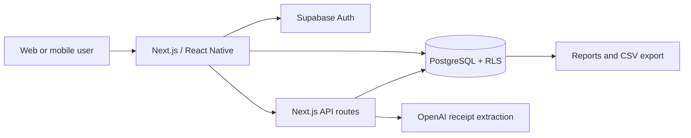

# Kotikassa

> Finnish for "home cash register" — a personal finance app for families.

> **Portfolio snapshot:** This repository is published for technical evaluation and is not presented as a hosted production service.

Track household **expenses** (via receipt scanning or manual entry), **income**, **savings goals**, **investments**, and **informal money with contacts** — all in one place, for the whole family.

Kotikassa is an independent product and portfolio project by **Chinthaka Chathurka**. It demonstrates full-stack product development across requirements, architecture, implementation, database security, testing, CI and operational safeguards.

## Engineering Highlights

- **Secure multi-tenant data model** — household isolation through PostgreSQL Row Level Security, authenticated RPCs and private receipt storage
- **Auditable AI receipt workflow** — structured model output, schema validation, privacy consent, rate limiting, scan-quality checks, human correction and reversible automation
- **Full testing pyramid** — unit and component tests, API contract tests, pgTAP database tests, Playwright workflows and accessibility checks
- **Production-minded delivery** — CI quality gates, database migration replay, isolated browser tests, error monitoring and documented architecture decisions
- **Bilingual product experience** — Finnish and English interfaces with shared web and mobile domain logic

## Architecture



Financial records and receipt images remain private to each household. The repository contains no production credentials or personal financial data.

## Features

- 📷 **Receipt scanning** — photograph Finnish grocery receipts; GPT-4o mini Vision extracts line items, Finnish dates are normalized deterministically, suspicious fields receive advisory quality warnings, and only measured low-risk name/store aliases can be applied automatically with a visible reason and immediate undo
- 💸 **Expense tracking** — manual entry with category, discount, quantity, and store fields
- 🔁 **Recurring expenses** — rent, loans, subscriptions auto-appear each month
- 💰 **Income, savings & investments** — full household financial picture
- 📊 **Budgets** — per-category monthly limits with dashboard alerts
- 📈 **Report generator** — build and compare financial, expense, income, category, store, item-purchase, budget, and people reports; safely group or separate saved product names; and export CSV
- 👥 **People tracker** — track money sent, lent, or borrowed with named contacts
- 🌍 **Multi-currency** — EUR, USD, LKR, DKK per family
- 👨‍👩‍👧 **Multi-user** — family group with shared data and invite links

## Tech Stack

| Layer            | Technology                                                                        |
| ---------------- | --------------------------------------------------------------------------------- |
| Web              | Next.js 14 (App Router), TypeScript strict                                        |
| Mobile           | React Native + Expo MVP in progress                                               |
| Monorepo         | Turborepo (`apps/web`, `packages/shared`, `packages/ocr`)                         |
| Database         | Supabase (PostgreSQL + Row Level Security)                                        |
| Auth             | Supabase Auth — email/password + Google OAuth                                     |
| Storage          | Supabase Storage — receipt images, RLS-protected                                  |
| Receipt scanning | GPT-4o mini Vision via `/api/scan` (ADR-015; model set by `OPENAI_RECEIPT_MODEL`) |
| UI               | shadcn/ui + Tailwind CSS                                                          |
| Charts           | Recharts                                                                          |
| i18n             | next-intl (Finnish + English)                                                     |
| Testing          | Vitest, React Testing Library, jsdom, MSW, pgTAP, Playwright, axe-core            |
| CI               | GitHub Actions with isolated quality, database/build, and browser jobs            |
| Error monitoring | Sentry                                                                            |
| Hosting          | Vercel                                                                            |

**Running cost: EUR 0/month** on Supabase + Vercel free tiers for a single-family deployment.

## Responsible AI-Assisted Development

AI development tools are used to accelerate implementation and review. Product requirements, architecture choices, security decisions, validation, testing and final acceptance remain human-owned. Generated changes are treated as untrusted until reviewed and verified through the same quality gates as manually written code.

## Testing

```bash
npm test           # all configured workspace tests through Turborepo
npm run test:unit  # all Vitest projects once
npm run test:watch # affected Vitest tests while developing
npm run test:coverage
npm run test:db     # pgTAP tests; requires the local Supabase stack
npm run test:db:reset # replay all migrations, then run pgTAP
npm run test:e2e    # reset local Supabase, seed, and run all Playwright tests
npm run test:e2e:no-reset # quicker E2E repeat without replaying migrations
npm run test:e2e:ui # Playwright UI mode against local services
npm run test:ci    # typecheck, web lint, and thresholded Vitest coverage
npm run build:ci   # production web build against loopback-only local Supabase
```

Normal automated tests use deterministic network and provider mocks and must not
call OpenAI. The web suite covers report and receipt-scan API contracts plus
critical report UI behaviour in English and Finnish. Database tests use
transaction-scoped fixtures and roll back after each pgTAP file. Browser E2E
tests use an isolated local household and cover critical workflows, desktop and
mobile smoke behavior, accessibility, and horizontal viewport overflow. The
default E2E command refuses non-loopback Supabase hosts before resetting data.
GitHub Actions runs the quality, database/build, and browser gates in parallel
and uploads coverage and Playwright diagnostics. Normal CI has an empty OpenAI
key and never receives production Supabase credentials.

## Documentation

- **[Setup guide](docs/setup.md)** — how to run locally and apply all database migrations
- **[Roadmap](ROADMAP.md)** — phases, feature checklists, what is planned
- **[Changelog](CHANGELOG.md)** — what changed in each release
- **[Architecture](ARCHITECTURE.html)** — technical reference (DB schema, system design)
- **[ADRs](docs/decisions/)** — architecture decision records

## Licence

This source is published for portfolio review. Copyright is retained by the author; see [LICENSE.md](LICENSE.md).
